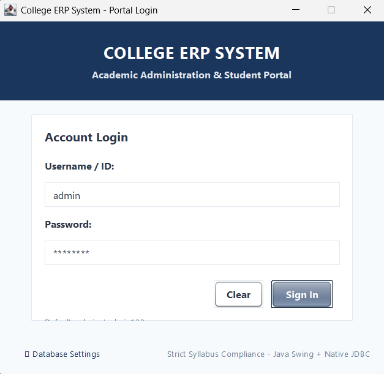
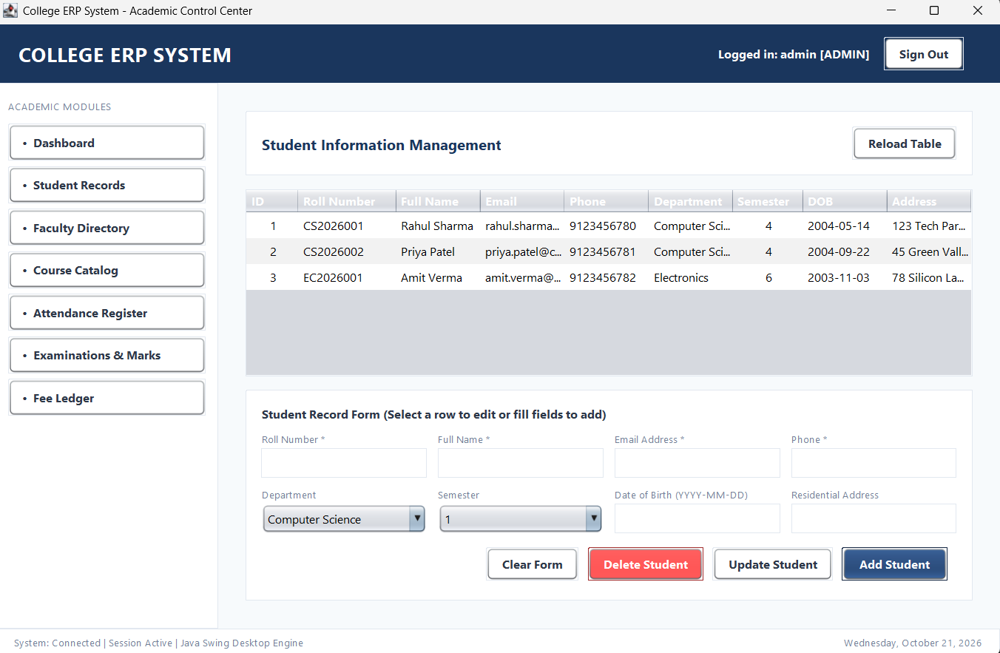

# College ERP System

> An enterprise-grade academic administration and resource planning desktop application built with Java, Swing, and Native JDBC with MySQL.

[](https://www.oracle.com/java/)
[](https://docs.oracle.com/javase/8/docs/technotes/guides/swing/)
[](https://www.mysql.com/)
[](LICENSE)

---

## 📌 Overview

The **College ERP System** is a modular, high-performance desktop application designed to streamline collegiate operations, faculty allocation, student enrollment, lecture attendance tracking, examination grading, and fee ledgers.

Built strictly with **Pure Java Swing/AWT** and **Native JDBC (`DriverManager`)**, this project follows an enterprise Data Access Object (DAO) architectural pattern with complete SQL injection prevention, strict Object-Oriented Design, and ACID-compliant transaction rollbacks.

---

## 📸 User Interface Preview

<!-- Placeholders for GUI Screenshots: Add your screenshots to a /screenshots folder and update the links below -->
<div align="center">
  
  <p><em>Figure 1: Role-Based Authentication & Database Connection Status</em></p>
  <br/>
  
  <p><em>Figure 2: Primary Management Dashboard (Student CRUD, Attendance Audit & Fee Ledger)</em></p>
</div>

---

## 🚀 Key Features & Modules

### 👨‍🎓 1. Student Management Module
* Complete CRUD operations (Add, Update, Delete, View) for student profiles.
* Filter and search student records by Roll Number, Department, and Semester.
* Real-time table synchronisation backed by prepared SQL statements.

### 👩‍🏫 2. Faculty Directory
* Instructor profile management including designation, department, and compensation.
* Direct object inheritance from base `Person` class demonstrating polymorphism.

### 📚 3. Course Catalog
* Semester-wise course code, title, and credit management.
* Relational foreign key bindings dynamically linking courses to qualified instructors.

### 📅 4. Lecture Attendance Register & Audit
* Daily lecture attendance logging (`PRESENT`, `ABSENT`, `LATE`).
* **Automated 75% Examination Eligibility Audit**: Instant evaluation calculating aggregate lecture attendance and flagging students below mandatory semester attendance thresholds.

### 📝 5. Examination & Grading Module
* Assessment marks entry with dynamic maximum score normalization.
* **Automated Grade Computation**: Internal business engine calculates letter grades (`A+`, `A`, `B+`, etc.) according to university grading policies.

### 💳 6. Institutional Fee Ledger & Financial Safety
* Student tuition fee accounts with real-time balance reconciliation.
* **ACID Transaction Management**: Multi-step payment transactions with `setAutoCommit(false)`, `commit()`, and `rollback()`.
* **Custom Exception Handling**: Custom checked `FeeException` actively prevents overpayments and illegal account debits.

---

## 🛠️ Tech Stack

* **Language**: Java (JDK 17+)
* **Graphical Interface**: Java Swing (`JFrame`, `JPanel`, `JTable`, `CardLayout`, `GridBagLayout`) & AWT Event Model
* **Persistence Layer**: Native JDBC (`java.sql.DriverManager`, `PreparedStatement`, `ResultSet`)
* **Database**: MySQL / MariaDB (hosted locally via **XAMPP** on port `3306`)
* **Software Engineering Principles**:
  * **OOP Concepts**: Encapsulation, Abstract Classes (`Person`), Inheritance (`Student`, `Faculty`), Polymorphism, and Interfaces (`FeeOperations`).
  * **Design Patterns**: Data Access Object (DAO) Pattern, Model-View-Controller (MVC) Separation, Singleton/Utility Connection Factory.
  * **Security**: Parameterized queries defending against SQL Injection vulnerabilities.

---

## 📂 Project Architecture

```text
college-erp-system/
│
├── bin/                             # Compiled Java bytecode (.class)
├── lib/                             # External dependencies
│   └── mysql-connector-j-8.3.0.jar  # Native MySQL JDBC Driver
│
├── sql/                             # Relational Schema & Seed Data
│   └── schema.sql                   # 7 normalized tables + seed accounts
│
├── src/                             # Application Source Code
│   └── com/college/
│       ├── Main.java                # Desktop Application Bootstrap
│       ├── db/
│       │   └── DBConnection.java    # Native JDBC DriverManager factory
│       ├── model/                   # Object-Oriented Domain Layer
│       │   ├── Person.java          # Abstract entity
│       │   ├── Student.java         # Subclass inheriting from Person
│       │   ├── Faculty.java         # Subclass inheriting from Person
│       │   ├── Course.java          # Academic course entity
│       │   ├── Attendance.java      # Lecture attendance entity
│       │   ├── Exam.java            # Examination & grading entity
│       │   ├── Fee.java             # Billing ledger entity
│       │   ├── FeeOperations.java   # Interface contract
│       │   ├── FeeException.java    # Custom checked exception
│       │   └── User.java            # Auth & Role-based entity
│       ├── dao/                     # JDBC DAO Layer (Parameterized Queries)
│       │   ├── StudentDAO.java
│       │   ├── FacultyDAO.java
│       │   ├── CourseDAO.java
│       │   ├── AttendanceDAO.java
│       │   ├── ExamDAO.java
│       │   ├── FeeDAO.java          # ACID transaction commit & rollback
│       │   └── UserDAO.java
│       ├── gui/                     # Swing UI Presentation Layer
│       │   ├── UITheme.java         # Typography, styles, palette tokens
│       │   ├── LoginFrame.java      # Authentication & DB configuration
│       │   ├── MainMenuFrame.java   # Main dashboard shell
│       │   ├── StudentPanel.java    # Student CRUD view
│       │   ├── FacultyPanel.java    # Faculty CRUD view
│       │   ├── CoursePanel.java     # Course catalog view
│       │   ├── AttendancePanel.java # Lecture register & 75% audit
│       │   ├── ExamPanel.java       # Grading entry view
│       │   └── FeePanel.java        # Financial transaction view
│       └── util/
│           └── DatabaseConfig.java  # External properties loader
│
├── db.properties                    # Local database configuration
├── db.properties.example            # Configuration template
├── run.bat                          # One-click Windows launch script
├── run.ps1                          # PowerShell compile & run script
├── setup_database.bat               # 1-click automated database schema importer
└── README.md                        # Documentation
```

---

## ⚙️ How to Run Locally

### Prerequisites
* **Java Development Kit (JDK 17+)** installed.
* **XAMPP** (or MySQL Server) installed.

### Step 1: Start MySQL in XAMPP
1. Open the **XAMPP Control Panel**.
2. Click **Start** next to **MySQL** (Default port: `3306`).
3. *(Optional)* Click **Start** next to **Apache** to view the database via phpMyAdmin at `http://localhost/phpmyadmin`.

### Step 2: Initialize Database Schema
Run the automated schema setup script:
* **Windows Batch**: Double-click `setup_database.bat`
* **PowerShell**: Run `.\setup_database.ps1`
* **Or Manual MySQL Terminal**:
  ```bash
  mysql -u root < sql/schema.sql
  ```
This creates the `college_erp` database, generates all 7 relational tables, and loads seed accounts.

### Step 3: Run the Application
Simply double-click:
```cmd
run.bat
```
Or execute via terminal:
```powershell
# Compile
javac -encoding UTF-8 -d bin -cp "lib/mysql-connector-j-8.3.0.jar;src" (Get-ChildItem -Recurse -Path "src\*.java").FullName

# Run
java -cp "bin;lib/mysql-connector-j-8.3.0.jar" com.college.Main
```

---

## 🔑 Default Login Credentials

| Role | Username | Password | Access Level |
| :--- | :--- | :--- | :--- |
| **Administrator** | `admin` | `admin123` | Full access to Students, Faculty, Courses, Attendance, Exams & Fees |
| **Faculty** | `faculty1` | `faculty123` | Faculty directory & Course grading |
| **Student** | `student1` | `student123` | Student portal & Fee/Attendance review |

---

## 📄 License
This project is open-source and available under the [MIT License](LICENSE).
